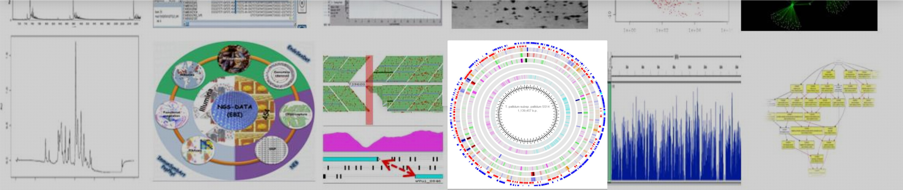

<picture>
  <source media="(prefers-color-scheme: dark)"
          srcset="./banner_02.PNG">
  <source media="(prefers-color-scheme: light)"
          srcset="./banner_02.PNG">
  
</picture>

  

<h1 align="center">eBIOINF</h1>

<h3 align="center">
  BIOINFORMATICS CORE FACILITY
</h3>

  <b>EBI · UMR CNRS 7267</b> 
  Computational Biology | Omics | HPC | Data Science

  
  
  
  

---

## 🧬 About eBIOINF

**eBIOINF** is the bioinformatics core facility of EBI,
UMR CNRS 7267.

Founded in 2012, the platform provides computational
resources, bioinformatics expertise and analytical
support for high-throughput sequencing and omics data.

Our expertise covers:

| Domain | Expertise |
|---|---|
| 🧬 Genomics | Genome assembly, annotation and comparative genomics |
| 🦠 Metagenomics | Microbial community analysis |
| 🧪 Transcriptomics | RNA-seq and differential expression |
| 🔬 Metatranscriptomics | Functional microbial activity |
| 📊 Bioinformatics | Statistical analysis and data visualization |
| 💻 HPC | High-performance computing and workflow development |

---

## 🖥️ Computing Infrastructure

Our platform provides dedicated computational resources
for demanding bioinformatics analyses.

### Computing Nodes

| Infrastructure | CPU Cores | RAM | Storage | Access |
|---|---:|---:|---:|---|
| Small Node | 12 | 144 GB | 22 TB | Interactive |
| Medium Node | 24 | 265 GB | 10 TB | Interactive |
| Big Node | 40 | 1 TB | 22 TB | Interactive |

### HPC Cluster

| Resource | Specification |
|---|---:|
| Computing nodes | 8 |
| Total CPU cores | 272 |
| Shared RAM | 3 TB |
| Computing power | 13 TFLOPS |
| Storage | 20 TB |
| Job scheduler | SLURM |

### Storage & Virtualization

| Infrastructure | Specification |
|---|---|
| NAS | 28 TB |
| Backup & Archiving | 70 TB |
| Virtual Machines | On demand |

---

## 🧰 Bioinformatics Tools

Coming soon...

## 🧑‍💻 In-house Development

Scripts, pipelines and tools developed by eBIOINF.

Coming soon...

---

## 👨‍🔬 Platform Team

**Bouziane MOUMEN**  
Bioinformatics Platform Manager

**Bioinformatics Research Engineer**  
CNRS

📧 bouziane.moumen[at]cnrs.fr

---

  
  &nbsp;&nbsp;&nbsp;&nbsp;
  

  <b>eBIOINF · EBI · UMR CNRS 7267</b> 
  Bioinformatics for Life Sciences

